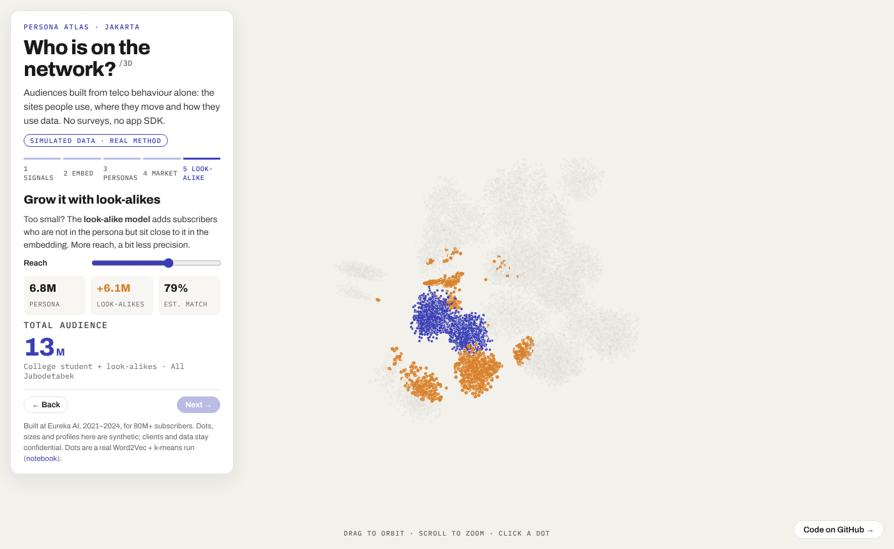
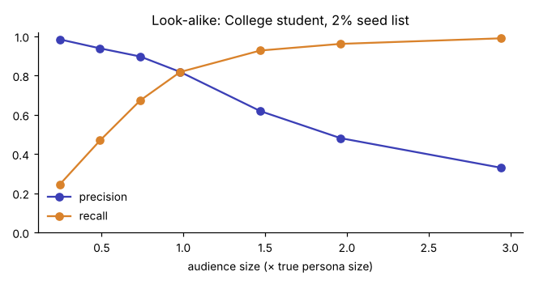

# Persona Atlas

**Who is on the network?** Telco behaviour → Word2Vec embeddings → personas → look-alike audiences.

[**▶ Live 3D demo**](https://dhaneswaramandrasa.github.io/persona-atlas/) · [Notebook](notebooks/persona_atlas.ipynb) · [Portfolio](https://dhaneswara-mandrasa.vercel.app)



> **Simulated data, real method.** I built the production version at Eureka AI (2021–2024): 30+ personas
> for 80M+ telco subscribers, sold as audiences to brands. Client data and code stay confidential, so this repo
> is a clean reimplementation on synthetic Jakarta data.

## The problem

A brand wants to reach *college students in Depok* or *moms with kids in BSD*. A mobile operator knows nothing
about who its subscribers are, only how they behave on the network:

| Signal | Example |
|---|---|
| Domains reached (DNS / SNI) | campus LMS, food delivery, gig-worker apps |
| Time | 3-hour buckets, night share |
| Location | home / work cell areas, daily mobility radius |
| Usage | GB per month, top-up pattern |

## The method

```
network events ──► daily token "sentences" ──► Word2Vec ──► subscriber vector ──► k-means (30)
  domain, time,       learning-01 t3 cell_depok     token      mean of tokens        named personas
  cell, volume        food-02 t4 video-03 ...       vectors    + usage features            │
                                                                                          ▼
                                     client seed list ──► cosine similarity ──► look-alike audience
```

1. **Simulate** 20,000 subscribers × 5 days from 30 personas (12 named, 18 generic). Everyone gets a personal twist on their persona's mix, and 15% of events are noise, so personas overlap.
2. **Embed** each day as a sentence. Word2Vec (skip-gram) learns that `learning-*` domains, late-night time buckets and campus cells go together.
3. **Cluster** subscriber vectors with k-means (k = 30). Adjusted Rand index ≈ 0.44, purity ≈ 67%: good enough to size markets, honest about overlap.
4. **Look-alike**: start from a 2% seed list and rank everyone by similarity.

| Audience size (× true persona) | 0.5× | 1× | 2× | 3× |
|---|---|---|---|---|
| Precision | 0.94 | 0.82 | 0.48 | 0.33 |
| Recall | 0.47 | 0.82 | 0.96 | 0.99 |



## The demo

`web/index.html` is a single page (deck.gl, no build step) that reads `web/data/points.json`, written by the notebook:

1. **Signals**: one subscriber's day as the network sees it
2. **Embed**: noise until behaviour is turned into vectors
3. **Personas**: points fly into their clusters; click one for its profile
4. **Market**: pick a persona and an area and get a reachable audience, with a Jabodetabek map of where it lives (home area = the cell a line sleeps in)
5. **Look-alike**: drag reach and watch the audience grow while match quality drops

Personas include high school student, college student, white collar, blue collar, informal worker, mom with kids,
night-shift worker, mobile gamer, Bodetabek commuter and retiree.

## Run it

```bash
pip install -r requirements.txt
cd notebooks && jupyter nbconvert --to notebook --execute --inplace persona_atlas.ipynb
cd ../web && python -m http.server 8000   # open http://localhost:8000
```

## Layout

```
persona_atlas/   personas.py (definitions) · simulate.py (synthetic network) · model.py (embed, cluster, look-alike, 3D layout)
notebooks/       persona_atlas.ipynb, the full walk-through with outputs
web/             interactive 3D demo + data/points.json
docs/            figures
```

## In production

PySpark to build token sequences from clickstream and cell data · Word2Vec on Spark · MLflow for runs ·
30+ personas reused as products across clients · audience sizing per city (Jakarta, Bangkok, Kuala Lumpur, Singapore).

---
Dhaneswara Mandrasa · MIT License
